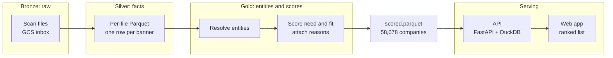
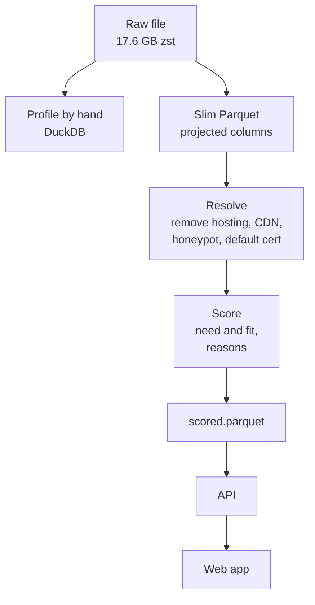
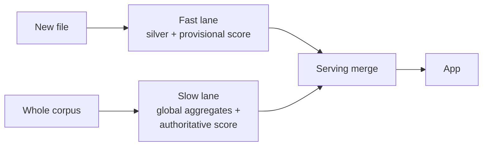
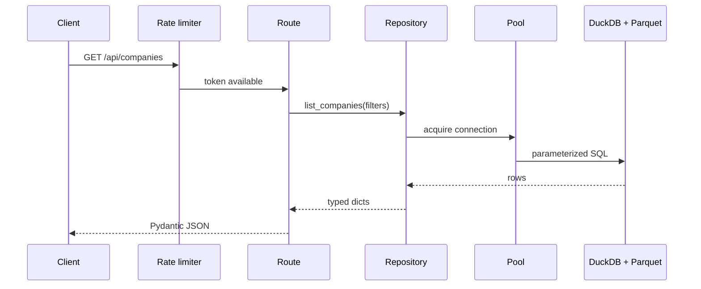
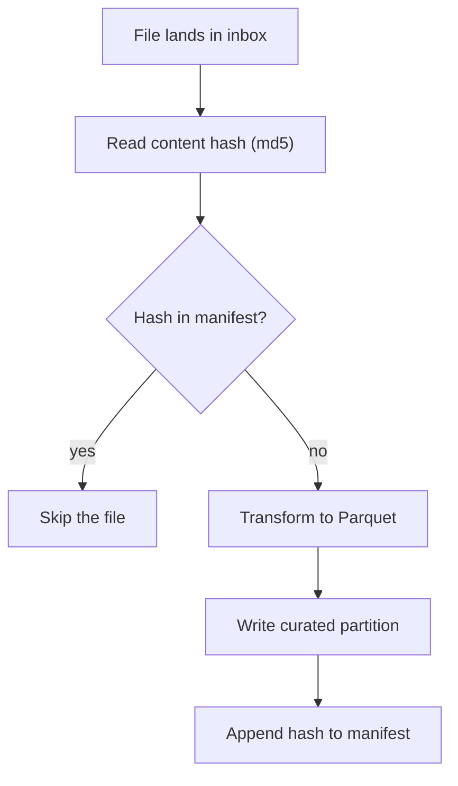

# Architecture

This document describes the system and how it scales. The system grows from one
scan file to one thousand files each month. The system adds a new file without a
reprocess of the full corpus.

## The constraint that drives the design

The task ranks companies by cybersecurity need. The data is internet-scan data.
One fact controls the design.

> The strongest signals are global aggregates. They are not per-record facts.

Resolution is the clearest example. A domain on more than 500 distinct IP
addresses is a host, not a company. You compute this rule across the full
corpus, not from one file. Several score features behave the same way. Therefore
one file alone cannot give a final score. This need for a corpus-wide view is the
reason for two lanes, not a need for speed.

A naive pipeline sends the file to a language model. It then ranks by
vulnerability count. That approach ranks hosting providers. Hosts carry the most
banners and the most CVE records. The resolution layer removes the hosts.

## System architecture

## Layers

The system uses four layers. Each layer has one job.

1. Bronze holds the raw files. Each file lands in GCS without change. The system
   partitions the files by scan date. The system moves old files to cold
   storage. This layer is the source of truth. The system never changes it.
2. Silver holds the facts. The step turns one banner into one typed row. The
   step keeps only the slim columns. The step runs per file and runs in
   parallel. An object-finalize event starts the step. A content hash makes the
   step idempotent.
3. Gold holds the entities and the scores. Resolution, feature aggregation, and
   the deterministic score run across the full corpus. The output is a small
   table of ranked companies. Each company carries a plain reason list.
4. Serving holds the read path. The API reads the gold table from a fast store.
   The app never queries the lake directly.

## Project flow

This diagram shows the stages from the raw file to the app.

The stages run in order.

1. Profile the data by hand first. Read the schema, the fill rates, and sample
   rows with DuckDB.
2. Build the slim Parquet. Keep only the columns the score needs.
3. Resolve the entities. Remove hosting, CDN, honeypots, and default
   certificates.
4. Score each company for need and for fit. Attach a reason list.
5. Write scored.parquet. The API reads this file.
6. Serve the ranked list in the web app.

## Fast lane and slow lane

The global-aggregate constraint forces two lanes. This diagram shows both lanes
and the merge.

1. The fast lane processes a new file in minutes. It writes silver. It computes a
   provisional score for the touched entities. It uses the last known global
   aggregates. It marks the score provisional.
2. The slow lane runs on a schedule. It recomputes the global aggregates. It
   computes the authoritative score across the full corpus. It overwrites the
   provisional score.
3. The serving layer merges the authoritative gold with the provisional deltas.

This pattern is Lambda architecture. The global-aggregate need justifies it here.

## API request flow

This diagram shows one request through the serving layer.

1. The rate limiter spends one token for the caller. An empty bucket returns
   HTTP 429 with a Retry-After header.
2. The route validates the query against a Pydantic model. A bad value returns
   HTTP 422.
3. The repository owns the SQL. It borrows one connection from the pool.
4. DuckDB runs the parameterized SQL over the Parquet.
5. The route returns the result as a typed JSON response.

## Ingestion idempotency

The pipeline processes each file once. The content hash is the key.

1. The worker reads the content hash of the file.
2. The worker checks the manifest for the hash.
3. The worker skips the file if the hash exists.
4. The worker transforms the file and writes the curated partition if the hash
   is new.
5. The worker appends the hash to the manifest.

## Engine choices

| Layer   | Engine                       | Reason                                                   |
| ------- | ---------------------------- | -------------------------------------------------------- |
| silver  | DuckDB, one worker per file  | A 20 GB file fits one large worker. DuckDB is fast here. |
| gold    | BigQuery or Spark / Dataflow | Global joins and aggregates run at terabyte scale.       |
| serving | DuckDB over a small Parquet  | The read is millisecond fast. No database runs.          |

The system uses the right tool for each layer.

## What this repository ships

This repository ships a runnable slice of the design.

1. The batch pipeline is in `pipeline/`.
2. The resolution and the scoring SQL are in `sql/`.
3. The serving API is in `services/api/`.
4. The thin web app is in `web/`.
