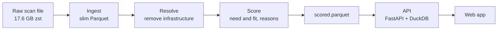

# Sales Intelligence Platform

This tool ranks the companies most likely to buy cybersecurity software. The
input is internet-scan data. The output is a ranked company list. Each company
shows a plain reason for its rank.

## Project flow

This diagram shows the stages from the raw file to the app.



The full architecture, the fast and slow lanes, the request flow, and the
idempotency flow are in `ARCHITECTURE.md`.

## Repository layout

```
pipeline/        Ingest raw scan files to curated Parquet. Streaming, idempotent, incremental.
sql/             Resolve entities, then score. Attach a reason list to each company.
services/api/    FastAPI serving layer. Connection pool, rate limit, Pydantic contract, tests.
web/             Thin Next.js app. Server-rendered account list for the sales team.
signals.md       Ranked signal thesis: each signal, its evidence, and its weight.
data-profile.md  By-hand profile of the full file: schema, fill rates, measured signals.
ARCHITECTURE.md  System design and diagrams.
```

## How the parts map to the grade

1. Signal insight. See `signals.md` for the ranked signal thesis and
   `data-profile.md` for the by-hand profile. The main finding: resolve before
   you score, or you rank hosting providers. The resolution and scoring run in
   `sql/30_resolve.sql` and `sql/40_score.sql`.
2. Ingestion that scales. See `pipeline/`. The worker runs per file. It is
   idempotent by content hash. It is incremental.
3. Transparent scoring. The need score and the fit score are separate. Each
   point maps to a named signal. Each company carries a reason list.
4. Measurement. The API and the SQL scoring have contract tests in
   `services/api/tests/`. The ranking-quality plan, a hand-labelled set and
   precision at k, is in `signals.md` and `data-profile.md`.
5. Thin app. See `web/`. The app is one screen. It is the least important part by
   design.

## Run

1. API. See `services/api/README.md`.
2. Web. Run: cd web, then yarn install, then yarn dev. Set API_URL to the API
   base address.
3. Pipeline and SQL. See `pipeline/README.md` and the comments in `sql/`.

## Deploy

1. The API and the web app deploy to Cloud Run from source.
2. Buildpacks build the image in the cloud. No local container runtime is needed.
3. See `services/api/README.md` for the deploy command.
