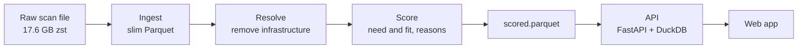

# Sales Intelligence Platform

Live app: https://sales-intelligence-platform-htvlzb7ksq-uc.a.run.app

This tool ranks the companies most likely to buy cybersecurity software. It reads
internet-scan data and returns a ranked company list, and it shows a plain reason
for every rank.

## Project flow

The stages run from the raw scan file to the app.



The full architecture, the fast and slow lanes, the request flow, and the
idempotency flow are in `docs/ARCHITECTURE.md`.

## Repository layout

```
pipeline/        Ingest raw scan files to curated Parquet. Streaming, idempotent, incremental.
sql/             Resolve entities, then score. Attach a reason list to each company.
services/api/    FastAPI serving layer. Connection pool, rate limit, Pydantic contract, tests.
web/             Thin Next.js app. Server-rendered account list for the sales team.
eval/            Reproducible ranking-quality measurement script and sample.
docs/            Write-up: signals, data profile, architecture, measurement, dev log.
```

## How the parts map to the grade

The brief grades a few things, in order, so the repo is organized around them.

1. Signal insight. The by-hand profile is in `docs/data-profile.md`, and the
   ranked thesis is in `docs/signals.md`. The finding that shapes everything:
   resolve before you score, or the list ranks hosting providers. The resolution
   and scoring run in `sql/30_resolve.sql` and `sql/40_score.sql`.
2. Ingestion that scales. The worker in `pipeline/` runs per file, skips a file it
   has already seen by content hash, and adds new files without a rebuild.
3. Transparent scoring. Need and fit are separate scores. Every point maps to a
   named signal, and each company carries its own reason list. Nothing is a black
   box.
4. Measurement. The API and the SQL scoring have contract tests in
   `services/api/tests/`. The ranking-quality numbers, precision at k, lift, and
   signal contribution, are in `docs/MEASUREMENT.md` and `eval/`.
5. Dev loop. How I used AI, what I checked, and where I caught it wrong, is in
   `docs/DEVLOG.md`.
6. The app. A thin, server-rendered screen in `web/`. The brief calls the UI the
   least interesting part, and I kept it that way.

## Run

1. API: see `services/api/README.md`.
2. Web: cd web, then yarn install, then yarn dev. Set API_URL to the API base
   address.
3. Pipeline and SQL: see `pipeline/README.md` and the comments in `sql/`.

## Deploy

The API and the web app both deploy to Cloud Run from source. Buildpacks build the
image in the cloud, so no container runtime runs on your machine. The deploy
command is in `services/api/README.md`.

## LLMs: where and why

The ranking uses no language model. The signals are deterministic, so they are
cheap, fast, and auditable. The brief warns that the best signals do not appear if
you hand the file to a language model, and the measurement backs that up. The
deterministic signals rank the companies well.

The ranking path spends no model tokens. It is SQL over Parquet.

A language model would earn its place in one spot, firmographic enrichment. A tool
could read a company's certificate name and hostnames and return a structured
industry and size band. It would be a named, versioned tool, with a schema, a cost
ceiling, a trace, and an eval set. It would stay out of the ranking and only label
a company for a filter. That is the next build.
